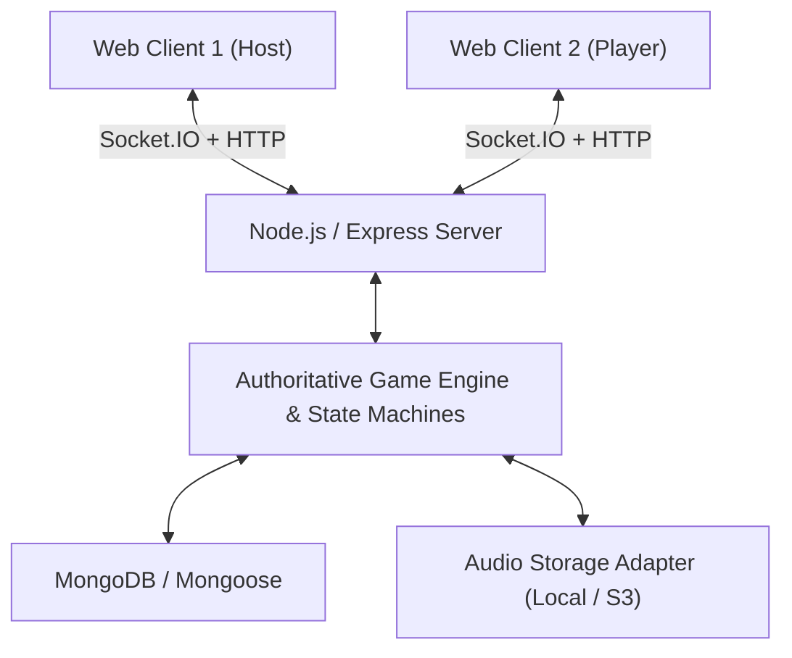

# Tune Clash - Architecture & System Design

## 1. System Overview
Tune Clash is an authoritative real-time multiplayer music guessing party game. The architecture guarantees answer secrecy, server-controlled timing, fair scoring, and resilient state synchronization.

## 2. Monorepo Organization
- **`apps/web`**: Next.js 14 App Router, React 18/19, Tailwind CSS with customized design tokens adhering to PRD 3.2.
- **`apps/server`**: Express API + Socket.IO server, authoritative state machines, Mongoose data models, local audio storage provider.
- **`packages/shared`**: Shared TypeScript types, Zod schemas, scoring engine, answer normalizer, and socket event contracts.
- **`scripts/`**: Synthetic demo melody generator and database seed utilities.
- **`docs/`**: Architecture, implementation notes, and testing documentation.

## 3. Authoritative Game State Machine
The server is strictly authoritative:
1. **Room State**: `lobby` -> `in_progress` -> `finished` -> `closed`
2. **GameSession State**: `created` -> `in_progress` -> `finished` -> `cancelled`
3. **Round State**: `preparing` -> `playing` -> `revealing` -> `finished` -> `cancelled`

### Synchronization and Timing
- Server assigns future `startAt` timestamp (~2 seconds ahead) during `round:prepare` to compensate for client buffering and clock variance.
- Total answer window is configured (default 12 seconds, or 8 seconds in Lightning mode).
- Timers run strictly on the server via `setTimeout` and timestamps recorded on server receipt.
- Guesses arriving after `answerDeadlineAt` are strictly rejected.

### Answer Secrecy
At no point prior to `round:ended` does the server transmit the correct song title, artist, aliases, or normalized strings to any client. Audio URLs are served with opaque IDs/tokens (`/api/assets/audio/:key`) rather than recognizable song names.

## 4. Database Strategy & Offline Resilience
- Mongoose schemas for `Track`, `MusicLicense`, `AudioAsset`, `Room`, `GameSession`, `RoundResult`, and `AuditLog`.
- When `MONGODB_URI` is provided (e.g. MongoDB Atlas or local daemon), Mongoose connects directly.
- For zero-friction development and automated testing, when `MONGODB_URI=memory` or unset, the server boots an embedded in-memory MongoDB instance.
